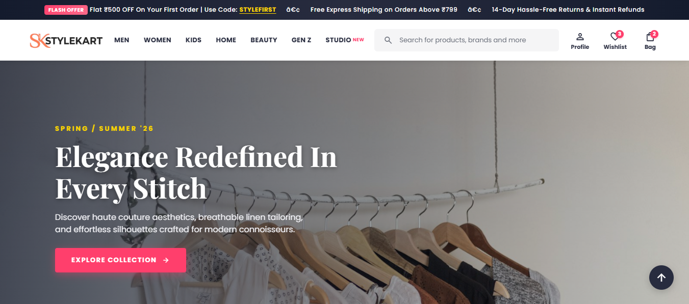
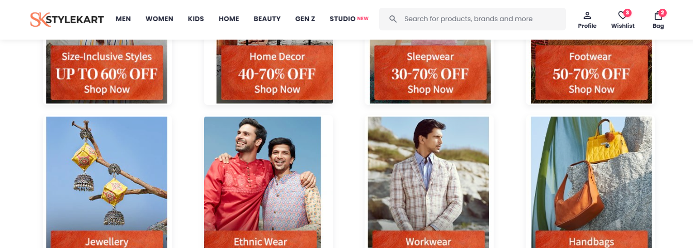
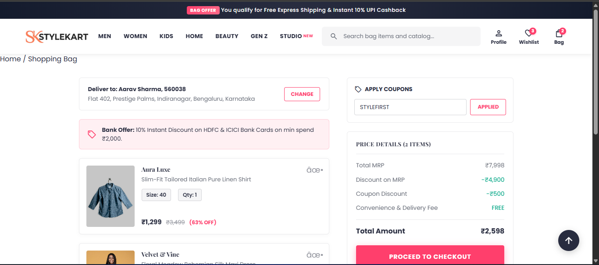
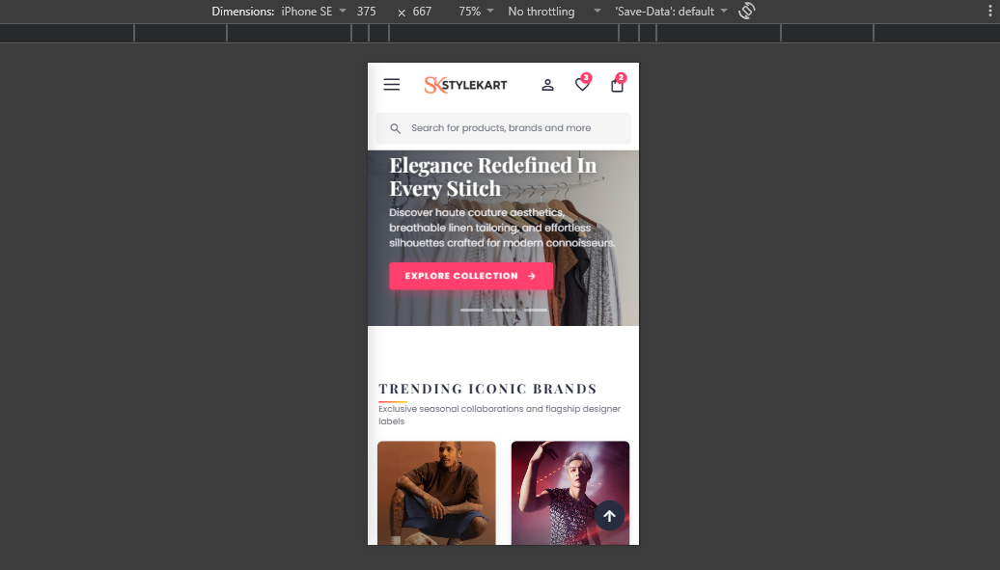

# StyleKart: Fashion E-Commerce Website UI

A responsive, multi-page fashion e-commerce website UI built with **HTML5 and CSS3 only** (no JavaScript, no frameworks). The layout is inspired by popular fashion marketplaces, while all branding and content are original.

**Repository:** https://github.com/shankarsala/stylekart-fashion-store

---

## Screenshots

| Home Page | Product Listing |
| --------- | --------------- |
|  |  |

| Shopping Bag | Mobile View |
| ------------ | ----------- |
|  |  |

---

## Features

- Sticky navbar with search bar and Profile / Wishlist / Bag actions
- CSS-only auto-sliding hero carousel
- Home sections: trending brands, categories, deals of the day, new arrivals, testimonials, newsletter
- Category pages (Men, Women, Kids, Home & Living, Beauty, Gen Z, Studio) with filter sidebar
- Product detail, wishlist, shopping bag (prices in ₹), login and contact pages
- Smooth CSS animations: card lift, image zoom, underline hover, heart pulse, bag bounce
- Fully responsive with a CSS-only hamburger menu
- Accessible: semantic HTML, alt text, aria-labels, focus styles

---

## Tech Stack

- HTML5
- CSS3 (Flexbox, Grid, variables, keyframes, media queries)
- Google Fonts (Playfair Display, Poppins)
- Material Symbols icons

---

## Project Structure

```
stylekart-fashion-store/
├── index.html
├── html/          # men, women, kids, home-living, beauty, genz, studio,
│                  # product, wishlist, bag, login, contact
├── css/           # base, navbar, home, footer, listing, product,
│                  # cart, auth, responsive
└── assets/
    └── images/    # banners, products, screenshots
```

---

## How to Run

1. Clone the repository:
   ```bash
   git clone https://github.com/shankarsala/stylekart-fashion-store.git
   ```
2. Open `index.html` in any modern browser.

No installation or build step is needed.

---

## Future Improvements

- Add JavaScript for a working cart, wishlist, and search
- Add product filtering and sorting
- Add dark mode

---

## Disclaimer

StyleKart is a student portfolio project made for learning. All brand names, logos, text, and products are fictional and original. It is not a real store.

---

## Author

**Shankar Sala**
GitHub: [@shankarsala](https://github.com/shankarsala)